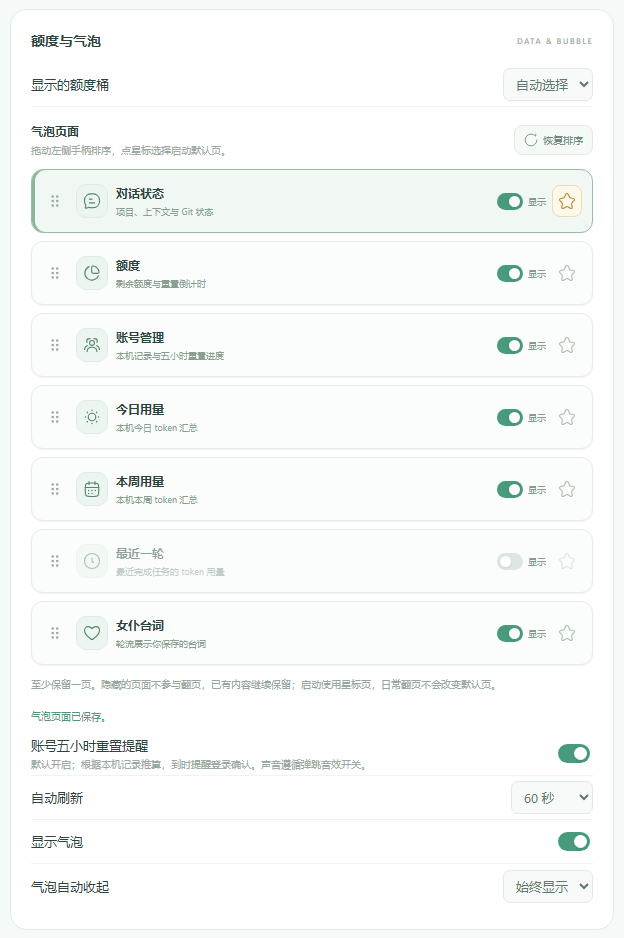
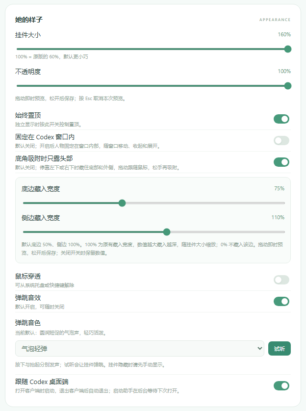

# Codex Maid Widget

**English** | [简体中文](README.zh-CN.md)

Contact: [feeesack9449@gmail.com](mailto:feeesack9449@gmail.com)

A small desktop companion for Codex. It shows your remaining quota and local token usage, and gives a little “duang” when a turn finishes. If you've wandered off to your phone, that might be your cue to come back.


## See it in action

Screenshots show the current Windows interface with **synthetic demo data**. Account names, conversation names, quota values and repository counts are examples. Click an image to view it at full size.

| Quota and the new dragon girl | Conversation context and Git | Multiple account countdowns |
| --- | --- | --- |
| [](docs/screenshots/release-0.3.48-quota.png) | [](docs/screenshots/release-0.3.48-conversation.png) | [](docs/screenshots/release-0.3.48-accounts.png) |

| Arrange and hide bubble pages | Appearance, corner peeking and audio | Built-in and imported characters |
| --- | --- | --- |
| [](docs/screenshots/release-0.3.48-pages.png) | [](docs/screenshots/release-0.3.48-appearance.png) | [](docs/screenshots/release-0.3.48-characters.png) |

## Download and install

The latest Windows and macOS installers are **v0.3.51**. This release keeps the bilingual interface from 0.3.49/0.3.50 and adds the macOS window-following, stacking-recovery and viewport-clipping fixes from PR #1. Download the installers below, or visit [Releases](https://github.com/Feeesack/codex-maid-widget/releases) for other versions.

| Platform | Installer |
| --- | --- |
| Windows x64 | [Download Windows installer (.exe)](https://github.com/Feeesack/codex-maid-widget/releases/download/v0.3.51/Codex-Maid-Widget-0.3.51-windows-x64-setup.exe) |
| macOS 13+, Apple Silicon and Intel | [Download universal Mac installer (.pkg)](https://github.com/Feeesack/codex-maid-widget/releases/download/v0.3.51/Codex-Maid-Widget-0.3.51-macOS-universal.pkg) |

Release notes and SHA-256 checksums are on the [Releases](https://github.com/Feeesack/codex-maid-widget/releases) page. The installers include the runtime and optional local Codex plugin, so you don't need to install Node.js or npm, or download the source.

The [0.3.48 release notes](docs/releases/0.3.48.md) bring together the changes since 0.3.21: paired press/release interactions; five sound choices including DSH Duck; multi-account reset reminders; two new dragon-girl poses; conversation context, compaction and Git status; Motion mirroring; Hugeicons controls; page ordering and visibility; live appearance and corner-hiding previews; and Windows installation-path fixes. Sound sources and their separate license scopes are documented in [audio provenance](docs/interaction-audio.md).

The [0.3.51 release notes](docs/releases/0.3.51.md) cover the macOS native-window fixes: more reliable Codex window identification, bounded visibility recovery, smoother following, corrected stacking after focus changes and `overflow: clip` for focused bubble content. Windows behavior, settings, imported characters and original assets are preserved. The Mac package is built and checked on native runners; hands-on acceptance for Spaces, full screen, multiple displays, Retina, audio and login sessions remains separate.

1. Install and sign in to the official Codex desktop app to see real account quota.
2. Run the installer, then open Codex Maid Widget from the Windows Start menu or macOS Applications folder.
3. Use the gear button, right-click the character, or open the system tray/menu bar menu to adjust settings.

From 0.3.49, choose **简体中文 / English** under **Interface language** at the top of Settings. Changes apply immediately and persist across restarts. Chinese remains the default; English has layouts adapted for longer labels. Custom phrases, names and project titles stay as written.

The installers don't yet have developer distribution certificates. The Mac app is ad-hoc signed, and the package has not been notarized by Apple. Your operating system may ask you to confirm its source. Use the downloads from this repository's Releases page and check the supplied checksum.

## Features

- Quota percentages and reset countdowns, with support for multiple quota buckets. Updates happen automatically, or when you click refresh.
- Local token totals for today, this week, and the most recently completed turn.
- A bounce and optional short sound when the widget sees a newly completed turn: “duang.” You can also click the character or use a shortcut to trigger it yourself.
- Automatic startup alongside Codex. A login helper waits in the background, opens the widget when Codex starts, and closes it after Codex fully quits. You can turn this off in settings.
- Four built-in characters, a local image library, custom phrases, and bubble colors that match the character.
- Dragging with a fixed character size, bottom-corner snapping, mirrored layouts, size and opacity settings, always-on-top, click-through, and remembered window placement. The character turns as you drag it across the screen's midpoint.
- Optional display inside the Codex window. On Windows, the character is attached to the main window and moves, minimizes and restores with it. On macOS, a separate widget window follows Codex's bounds and visibility.
- Optional head peeking at the two bottom corners. Drag inward to reveal the whole character; release near a bottom corner to let it settle back.
- Bubble auto-collapse after 3, 5, 10, 30 or 60 seconds, or keep it visible. The default is 5 seconds; saved choices are retained on upgrade.
- Always-on breathing, bouncing, rolling numbers, and a shimmer on quota values. Sound is optional.
- An optional local MCP plugin so Codex can read widget status, refresh quota, show or hide the widget, trigger a bounce, or open settings.
- The conversation page shows the selected conversation's name and project, context usage, Git uncommitted-file count and recorded compaction count. Turn to the page or click its bubble to read; there is no extra conversation polling. Automatic detection has a manual fallback listing up to 30 recent eligible local conversations. Compaction counts combine automatic and manual operations confirmed by local checkpoints; incomplete history is marked. The Git number counts uncommitted worktree files, including untracked files, rather than commits waiting to be pushed.
- The account page records accounts observed on this device, with profile nicknames, available workspace names and editable local aliases. Missing nicknames are explicitly marked; email addresses are not used as nicknames. Display metadata stays local and out of MCP. Each observed five-hour window has a reset progress bar and countdown. A reset reminder shows widget text, four bounces in one second and one short sound. Historical estimates require login to confirm; sound and reminders can be disabled. This is a local record of observed accounts, not an account switcher or simultaneous live connection to all accounts.
- Press and release have separate animations and matching audio. Rapid clicks continue from the displayed pose; dragging holds the pressed pose until release. Five sound choices and a mute-aware preview are available in settings.
- Bubble pages can be reordered, hidden and assigned a startup default. SortableJS handles card dragging, with keyboard ordering also supported. Previous/next arrows follow the configured visible order in both directions.
- Size and opacity preview continuously while dragging. Corner-peeking settings provide independent bottom and side hiding sliders from 0% to 200%, defaulting to 50% and 100%; saved choices are retained. Motion animates mirroring, and Hugeicons supplies the toolbar and page-editor controls.

Quota percentages come from the account currently signed in to Codex. Token totals add up the available session logs from **all accounts on this device**, with the week starting on Monday in local time. The widget marks missing or incomplete records. These are local usage counts, not a bill or an account total across devices.

## Controls

| Action | Control |
| --- | --- |
| Move | Drag the character or bubble |
| Refresh | Click the bubble or refresh button |
| Change bubble view | Previous/next arrows: quota, conversation, accounts, today, week, last turn, phrases; order and visibility are configurable |
| Bounce / interaction | Click the character or heart; press `Q` or Space while focused |
| Settings | Gear, right-click, or tray/menu bar |
| Show / hide | Windows `Ctrl+Alt+M`; Mac `Control+Option+M` |
| Bounce | Windows `Ctrl+Alt+Q`; Mac `Control+Option+Q` |
| Toggle click-through | Windows `Ctrl+Alt+Shift+M`; Mac `Control+Option+Shift+M` |
| Restore position / quit | Tray/menu bar menu |

If another app uses the same shortcut, you can use the tray/menu bar instead. Hover over the character to show a bubble that has been automatically hidden.

### Window display and corner peeking

Both options are off by default. On Windows, enable **Stay inside the Codex window** (**固定在 Codex 窗口内**) in settings to keep the character inside Codex. It follows the main window's movement and system minimize/restore animation. Other apps and dialogs cover it according to normal window ordering, and it does not float above them. Turning the option off restores the saved desktop position and always-on-top preference.

On macOS, the equivalent option is labelled **Show only inside the Codex window** (**仅在 Codex 窗口内显示**). It uses a separate window, hides when another app is active or Codex is minimized, and does not use Windows native child-window attachment. Mac Spaces and full-screen behavior still need hands-on validation.

Enable **Peek from a bottom corner** (**底角吸附时只露头部**) to tuck the character behind the side and bottom edges at either bottom corner. Dragging inward gradually brings the full character into view; dragging outward keeps it following the pointer. Releasing near a bottom corner snaps it back with a short settling animation. Other edges do not attract the widget. This works in desktop mode and inside Codex.

### Automatic startup

Open the widget once after installation to register the login helper for your user account. **Follow Codex desktop** is on by default: the helper starts when you log in, waits for Codex, then opens the widget. Sending Codex to the background doesn't count as quitting it. If you quit the widget yourself, it stays closed until a new Codex desktop session starts.

Turning off the follow setting removes the helper's login registration. If the operating system blocks background startup, the settings page will report it. Check Startup Apps on Windows or Login Items & Extensions on macOS.

### Optional Codex tools

- **Windows:** select “Connect Codex plugin” at the end of installation, or use its Start menu shortcut.
- **macOS:** choose **Connect Codex tools…** (**连接 Codex 工具…**) from the widget's menu bar menu, or use the installed connection launcher.

This registers a local plugin through the official Codex CLI. After connecting, restart Codex and start a new chat. Keep the widget running while using its tools. The connector uses the installer's bundled runtime, so no separate Node.js installation is needed. It only changes the connection setup when you choose to run it.

Before uninstalling a connected widget, use **Disconnect Codex plugin** in the Windows Start menu, or **Codex-Maid-Widget-断开 Codex.command** in Mac Applications. This removes the widget's local plugin, keeps your images and settings, and leaves other plugins alone. Restart Codex afterwards. The Windows uninstaller also offers this step; for silent uninstallation, disconnect first.

## Data and privacy

The widget gets quota from the local Codex app-server and extracts conversation metadata and numeric counter/checkpoint events from local session and archived-session records, without exporting conversation text. It asks for no API key, sends no prompts to a model and has no application analytics.

For account nicknames and workspace names, the packaged app can use existing local sign-in credentials within its main process to make read-only requests to fixed official profile endpoints. It does not refresh sign-in or store credentials in account records, logs, control responses or MCP output. Display names and aliases stay local. Profile lookup failure does not prevent quota reading.

Imported images still use their filenames as the default local names. Those names, including any labels you edit, stay out of MCP tool results; tools use fixed built-in labels or “自定义形象” (custom character).

Settings, imported character images, and local integration files live in `~/.codex-maid-widget`. The optional control interface listens only on loopback, uses a new random token each time the widget starts, and accepts a fixed set of widget actions. It can't run arbitrary commands or fetch URLs.

Please remove account details, credentials, personal paths, and conversation content before posting an issue or screenshot. To report a security issue, see [SECURITY.md](SECURITY.md).

## Build from source

You'll need Node.js **22.12 or newer** and a development environment for the platform you're building. The lockfiles pin dependency versions.

Windows, from the repository root:

```powershell
npm ci
npm test
npm run build
node distribution/windows/build.cjs
```

macOS, on a Mac:

```sh
cd macos
npm ci
npm test
npm run build:installer
```

Windows and macOS use the same release version. The build stops if their manifests disagree. Packaging instructions are in [distribution/README.md](distribution/README.md); contribution notes are in [CONTRIBUTING.md](CONTRIBUTING.md).

## Testing

Windows 0.3.51 has local runtime evidence for main-app and helper versions, non-demo quota, local controls and MCP. Automated regression covers both source trees, including rendering, settings, data parsing, interactions and path compatibility. The universal Mac installer is built on a native runner, with installation, launch, MCP, native window and launchd-helper checks on Apple Silicon and Intel runners.

CI does not replace hands-on Mac acceptance for multiple monitors, Spaces, full screen, Retina, audio and login sessions. Subjective sound and animation feel, real five-hour reset reminders and Windows sign-out/sign-in also need hands-on acceptance.

## Acknowledgements and licenses

- The original mint maid, lilac dragon maid and app icon artwork were generated with **GPTimage2.5**, as stated by the project author. These materials use [CC BY 4.0](licenses/CC-BY-4.0.txt); credit **Codex Maid Widget contributors** and link to this repository when reusing them. The user supplied the two 小龙娘 images and authorized their names and built-in use in this project; no additional copyright or reuse license is asserted for them. See [asset provenance](docs/asset-provenance.md) and [artwork scope](ARTWORK_LICENSE.md).
- Thanks to the maintainers and contributors of [MeteorNOX/DeepSeek-Balance-Whale-Widget](https://github.com/MeteorNOX/DeepSeek-Balance-Whale-Widget), the DeepSeek/DSH whale widget. Its companion, speech bubble, drag-and-snap behavior and interactions inspired this project. The new dragon-girl expressions take inspiration from its round cheeks, large eyes and slightly lowered brows while keeping this project's GPT dragon-girl features. DSH Duck sound sources and their separate rights scope are recorded in [audio provenance](docs/interaction-audio.md).
- [Yang-huai406/Codex-Whale-Public](https://github.com/Yang-huai406/Codex-Whale-Public) was another reference for a Codex desktop companion. The visibility recovery module adapts its MIT-licensed implementation and retains the license notice. The interface, artwork and quota reader are separate.
- [Hugeicons](https://github.com/hugeicons/hugeicons), [Motion](https://github.com/motiondivision/motion) and [SortableJS](https://github.com/SortableJS/Sortable) provide the free UI icon subset, mirror animation and page ordering. Pinned assets and their MIT notices are bundled locally. Interaction audio also includes CC0 [Kenney](https://kenney.nl/assets/interface-sounds) samples and the project's synthesized chirp; see [audio provenance](docs/interaction-audio.md).
- This app uses [Electron](https://www.electronjs.org/), [Node.js](https://nodejs.org/), [Inno Setup](https://jrsoftware.org/isinfo.php), and the Codex app-server and plugin interfaces. Their licenses remain with their respective authors.
- The bundled OpenAI mark comes from the [official OpenAI Agents repository](https://github.com/openai/openai-agents-python/blob/main/docs/assets/logo.svg). It is not covered by this project's artwork license, and its inclusion grants no trademark rights or endorsement.

The original code is licensed under [MIT](LICENSE). See [NOTICE](NOTICE) and [asset provenance](docs/asset-provenance.md) for artwork and third-party notices. This is a community project, unaffiliated with OpenAI.
